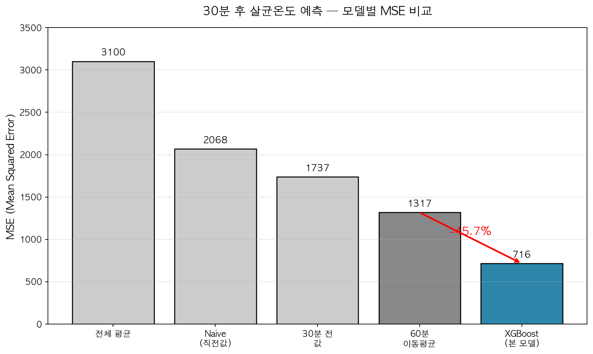
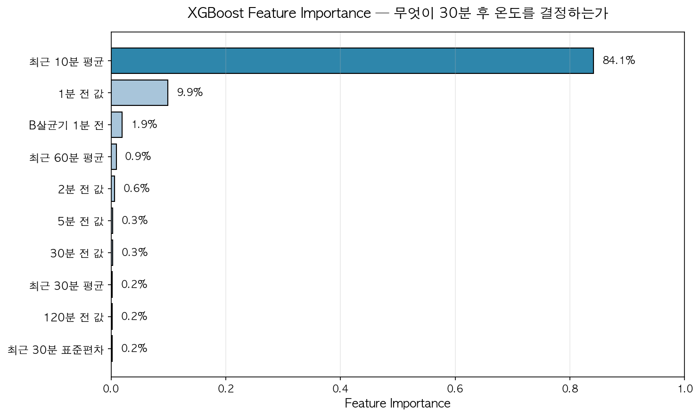

# 살균 공정 30분 후 온도 예측 (XGBoost)

제9회 인공지능 및 데이터 분석 연구 경진대회 **1학년 부문 금상(1위)** 제출 코드입니다.
식품 살균 공정(HACCP 중요관리점)의 살균기 온도를 **30분 앞서** 예측합니다.

## 결과

| 항목 | 값 |
|---|---|
| 베이스라인 (60분 이동평균) MSE | 1,317.06 |
| **XGBoost MSE** | **715.71 (−45.7%)** |
| RMSE | 26.75 (원 단위 기준, 약 2.68℃) |
| 입력 변수 | 19개 |

- 가설 "직전 1분 값이 가장 강한 예측 변수일 것"은 **틀렸습니다.** XGBoost 변수 중요도에서 최근 10분 평균이 84.1%, 직전 1분 값이 9.9%였습니다.
- 1분 뒤 예측에서는 단순 직전값(Naive)이 우세하고, 30분 뒤 예측에서 모델이 베이스라인을 크게 앞섭니다.

## 코드 순서

| 파일 | 내용 |
|---|---|
| `day1_eda.py`, `day2_eda_deep.py` | 탐색적 분석 |
| `day3_preprocess.py` | 오류값 제거, 1분 리샘플링 + 선형 보간, 시계열 순서를 지킨 8:1:1 분할 |
| `day4_baseline.py`, `day4_baseline_30min.py` | Naive·이동평균 베이스라인 MSE |
| `day5_xgboost.py` | Lag(1–120분)·이동통계(10/30/60분)·B살균기·시간 변수 19개 → XGBoost (early stopping) |
| `day6_ppt_visuals.py` | 발표용 그래프 |

## 데이터

KAMP(한국 인공지능 제조 플랫폼) **살균기 AI 데이터셋**을 사용했습니다. 원본 데이터는 재배포하지 않으니 KAMP에서 직접 받아 `pasteurizer.csv`로 두고 `day3_preprocess.py`부터 실행하세요.

## 한계

- 설비 세팅이 바뀌는 급변 구간에서는 예측이 늦습니다.
- 8.5개월 데이터라 계절성(연간 패턴)은 학습하지 못했습니다.
- 현장 경보로 운영해 보지는 않았습니다.

— 김지훈 (Jihoon Kim), 성결대학교 산업경영공학과
